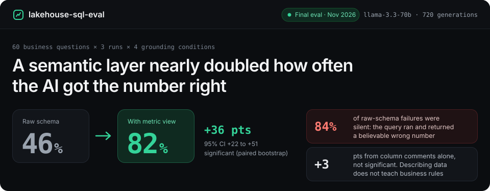
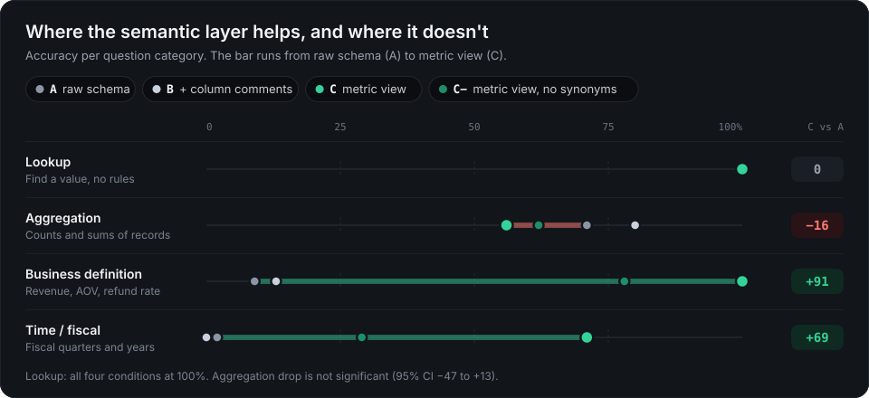
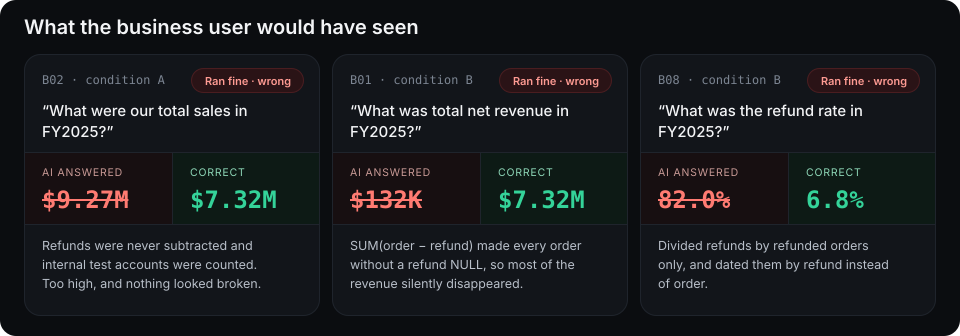
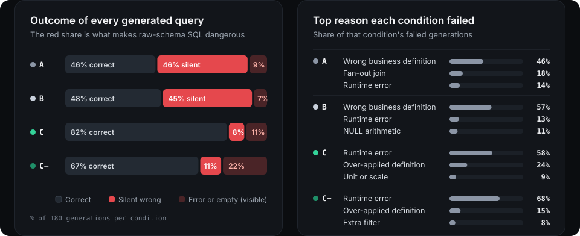
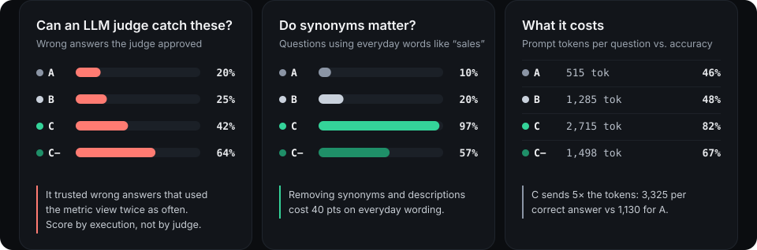
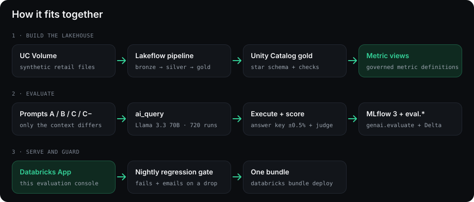

<p align="center">
  
</p>

<p align="center">
  <b>Does a semantic layer make text-to-SQL trustworthy?</b><br>
  An end-to-end Databricks project that scores LLM-written SQL by the number it returns, not just whether it runs.<br>
</p>



<br>



<br>



<br>



## What I found

| | Condition | What the model sees | Accuracy (95% CI) |
|---|---|---|---|
| **A** | raw schema | table and column names, types | 45.6% (33–58) |
| **B** | + column comments | A + data-catalog descriptions | 48.3% (35–62) |
| **C** | metric view | A + Unity Catalog metric views | **81.7% (72–91)** |
| **C−** | metric view, no synonyms | C without synonyms, names, descriptions | 67.2% (56–78) |

1. **The semantic layer added +36 points** (paired bootstrap 95% CI +22 to +51), almost all of it on business-definition (9% → 100%) and fiscal-calendar (2% → 71%) questions.
2. **Column comments alone did nothing measurable** (+3, CI includes 0). Describing columns doesn't teach the model how the business counts.
3. **Most raw-schema failures were silent.** 84% of A's failures ran and returned a plausible wrong number.
4. **Synonyms and descriptions are worth +14 points** (CI +4 to +24), and 40 points on everyday wording like “sales”.
5. **An LLM judge is not a safe gate.** It approved 42% of wrong answers that used the metric view versus 20% for raw schema: governed-looking SQL earns unearned trust.
6. **The trade-off:** governed definitions slightly hurt raw-record counting questions (−16, not significant) because the model sent them through the metric view, which filters test accounts by design.

<br>



## How it works

Synthetic retail data (200k orders, 3 fiscal years) is full of deliberate traps: ~8% refunds, a fiscal year starting Feb 1, five currencies, soft-deleted customers, internal test accounts, duplicates and bad rows. Sixty questions in four categories each have a hand-written gold query; the 30 business and time questions are also answered through the metric view, and both answers must agree before the benchmark is used.

Each condition is generated 3× at temperature 0.2 with `ai_query`. Every query is executed read-only with a timeout and compared to the gold result (numbers within 0.5%, extra columns and row order allowed), then labelled *correct*, *silent wrong*, *empty* or *error*. Confidence intervals come from a bootstrap that resamples **questions**; condition comparisons use a **paired** bootstrap. A nightly job reruns everything and fails, with an email, if accuracy or the silent-wrong rate regresses.

The interactive version of these panels runs as a **Databricks App** inside the workspace. Databricks Apps require a workspace login, so this README shows the same views as images.

## Reproduce it on Databricks Free Edition

1. Sign up for [Databricks Free Edition](https://www.databricks.com/learn/free-edition), install the [Databricks CLI](https://docs.databricks.com/aws/en/dev-tools/cli/install), and run `databricks auth login --host <workspace-url>`.
2. In the SQL editor: `CREATE SCHEMA workspace.bronze; CREATE SCHEMA workspace.silver; CREATE SCHEMA workspace.gold; CREATE SCHEMA workspace.eval;`
3. In `databricks.yml`, set your workspace host, a chat endpoint from **Serving** (`llm_endpoint`; a non-reasoning model works best) and your SQL warehouse name.
4. Run:
   ```bash
   python src/questions/build_questions.py && python -m pytest -q tests
   databricks bundle deploy
   databricks bundle run build_data            # data + pipeline + checks
   databricks bundle run build_semantic_layer  # metric views + validate 60 answers
   databricks bundle run generate_sql          # 720 LLM generations (re-run if quota hits)
   databricks bundle run evaluate_sql          # execute, judge, score, MLflow
   databricks bundle run analyze_results       # taxonomy, figures
   databricks bundle run eval_console          # start the app
   ```
5. Give the app read access. Copy its service principal ID from **Compute → Apps → sql-eval-console → Authorization**, then:
   ```sql
   GRANT USE CATALOG ON CATALOG workspace TO `<app-service-principal-id>`;
   GRANT USE SCHEMA, SELECT ON SCHEMA workspace.eval TO `<app-service-principal-id>`;
   ```

## Repo layout

```
databricks.yml                     bundle: variables, targets
resources/                         pipeline, jobs (data, semantic, generate, evaluate, analyze, nightly), app
src/data/generate_data.py          synthetic retail data with deliberate traps
src/pipeline/                      Lakeflow bronze / silver / gold with data-quality expectations
src/semantic/*.yaml                Unity Catalog metric views (+ no-synonym ablation)
src/questions/build_questions.py   60 questions, gold SQL + metric-view SQL
src/catalog/column_comments.yaml   data-catalog descriptions (condition B)
src/generate/                      prompt builder + ai_query generation (resumable)
src/evaluate/                      executor, scorers, LLM judge, MLflow, bootstrap CIs, regression gate
src/analysis/                      failure taxonomy + report figures
src/app/                           Databricks App: the evaluation console
docs/readme/                       README panels (python docs/readme/make_svgs.py)
tests/                             46 unit tests
reports/                           report.md, hypotheses.md, figures/
```

## Hypotheses (written before the run)

| | Prediction | Result |
|---|---|---|
| H1 | Gain concentrated on business-definition questions | ✅ +91 pts there, 0 on lookups |
| H1b | Column comments help (~+15 pts) | ❌ +3 pts, not significant |
| H2 | ≥70% of raw-schema failures are silent | ✅ 84% |
| H3 | Synonyms worth 5–15 pts | ✅ +14 pts |

## Limitations

One model (Llama 3.3 70B); synthetic data; 15 questions per category, so intervals are wide; I wrote both the questions and the metric view; the judge is the same model as the generator. Details and an audit fix (a scorer row-order bug, corrected before final numbers) are in [the report](reports/report.md).