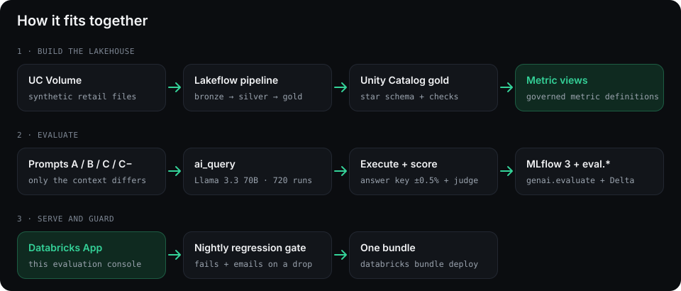
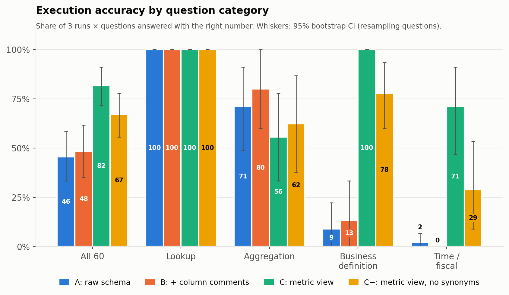
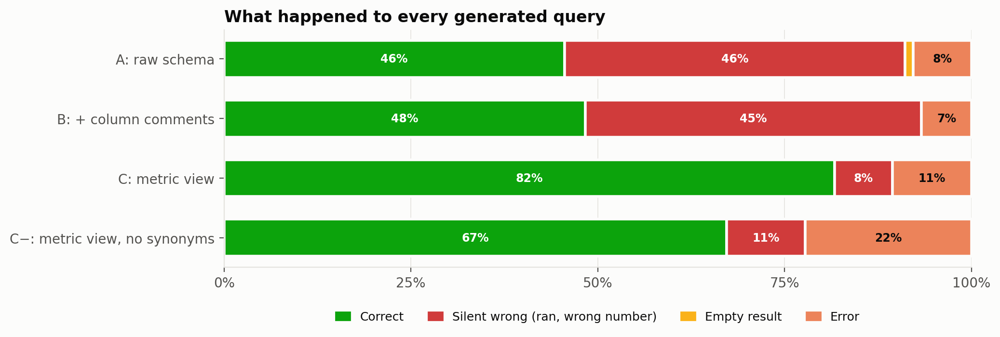
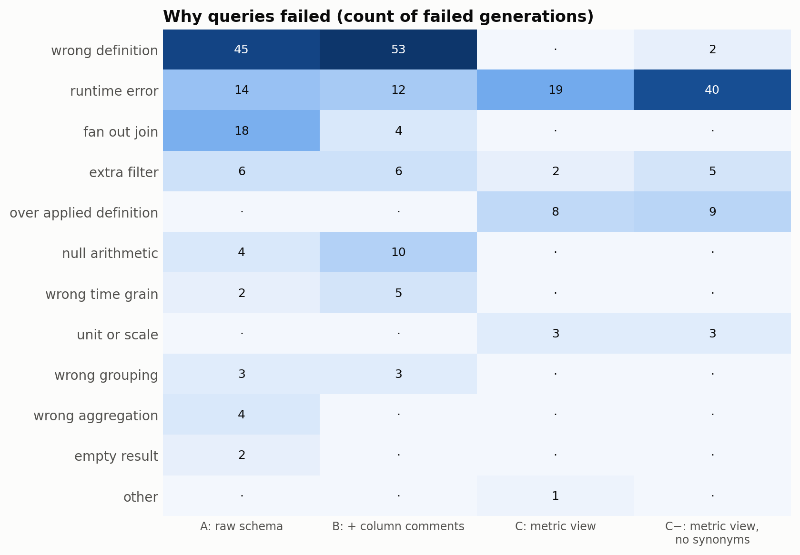
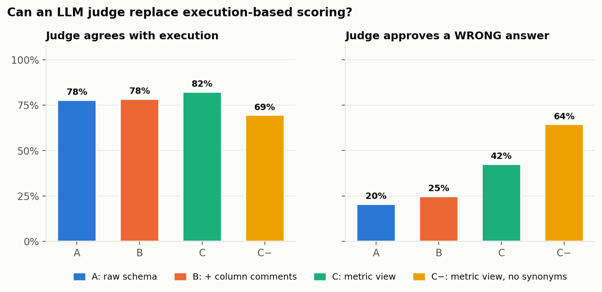
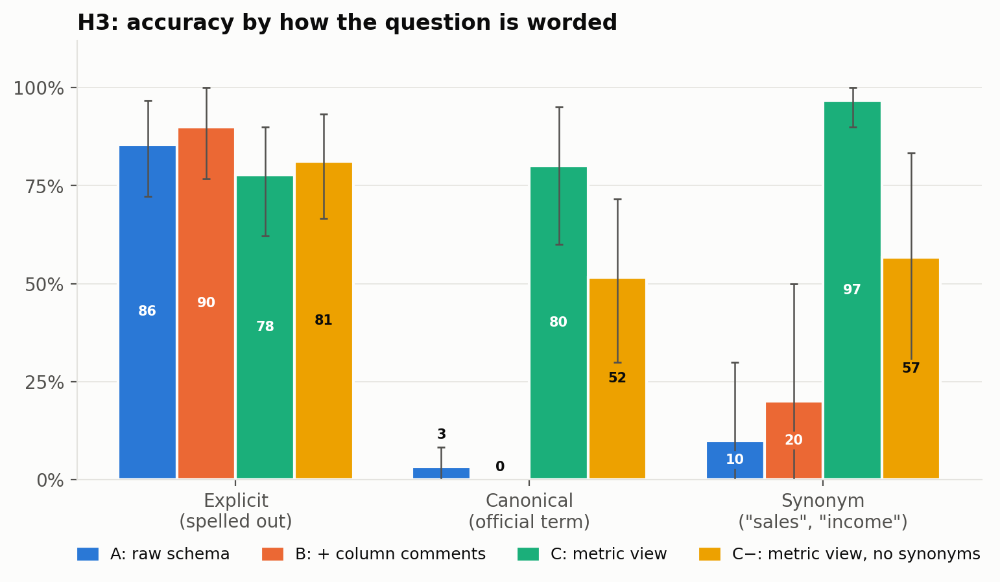
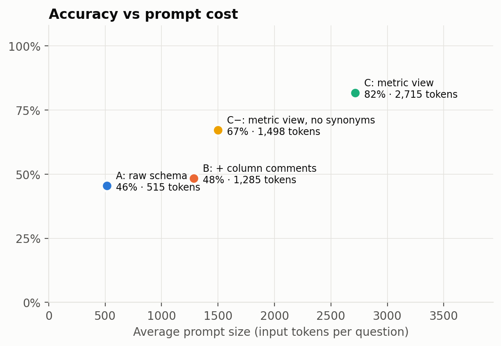

# Define It Once: Does a Semantic Layer Make Text-to-SQL Trustworthy?

**Vatsal Roy · November 2026 · [Code and data pipeline](https://github.com/VatsalRoy/lakehouse-sql-eval)**

> **The one-sentence answer.** When an LLM writes SQL from the raw database schema, it gets the right number about half the time, and most of its mistakes look perfectly fine. Giving it a governed semantic layer (a Unity Catalog metric view) raised accuracy from **46% to 82%** and cut silent wrong answers from **46% to 8%** of all responses.

---

## the error nobody notices

"Text-to-SQL" means asking a database a question in plain English ("What were our sales last quarter?") and letting an AI model write the SQL query that answers it. The demos are impressive. The risk is less obvious.

A broken query is not the real danger, because a broken query throws an error and a person notices. The real danger is a query that **runs fine and returns a believable number that is wrong**. I call this a **silent wrong answer**. Here is the example that started the project:

| | |
|---|---|
| Question | "What were our total sales in FY2025?" |
| AI's answer | **$9.27M** |
| Correct answer | **$7.32M** |
| What went wrong | The model added up every order. It did not subtract refunds, and it counted orders from internal test accounts. |
| Did anything look broken? | No. The query was valid SQL, it ran in under a second, and $9.27M is a plausible number. |

The model didn't fail at SQL. It failed at **business definitions**: what this company means by "sales", which accounts count, and when its fiscal year starts. Those rules usually live in people's heads, in a BI tool, or in a wiki page, not in the database schema the model reads.

**Semantic layers** are the industry's answer to this. A semantic layer is a place where metrics are **defined once**, in code, and reused everywhere: "net revenue = gross order value minus refunds, excluding test accounts, converted to USD." Databricks implements this as **metric views** in Unity Catalog. The open question is whether handing the model a semantic layer actually makes its answers correct, and by how much.

---

## the question and what I predicted

**Research question.** If the same model answers the same business questions, how much does its *execution accuracy* (the share of queries that return the correct result) change when it sees:

- **A — raw schema:** table names, column names and data types only
- **B — raw schema + column comments:** A plus data-catalog descriptions of each column
- **C — metric view:** A plus the governed metric views, with their definitions, synonyms and descriptions
- **C− — metric view without synonyms:** C with the synonyms, display names and descriptions removed (an **ablation**, meaning a version with one ingredient taken out, so we can measure what that ingredient is worth)

**Why compare four, not two?** Each condition isolates one idea:

| Comparison | What it tests |
|---|---|
| B vs A | Is *documentation* enough? |
| C vs A | Does a *semantic layer* help? |
| C vs C− | Is the help coming from the metric *definitions* or from the *words* (synonyms, descriptions) attached to them? |

**Hypotheses, written down before running anything** (in [`hypotheses.md`](hypotheses.md)). Writing predictions first is called **pre-registration**. It stops you from looking at the results and then deciding what you "expected".

| | Hypothesis | Why I believed it |
|---|---|---|
| **H1** | C beats A, and the gain is concentrated on business-definition and fiscal questions, with little change on simple lookups. | Lookups need no business rules; definitions are exactly what the metric view adds. |
| **H1b** | Column comments (B) help, by roughly +15 points over A. | Comments describe columns like `is_test_account`, which should hint at the rules. |
| **H2** | At least 70% of A's failures are *silent* (run fine, wrong number). | The model writes valid SQL easily; the mistakes are in meaning, not syntax. |
| **H3** | Synonyms and descriptions are worth 5–15 points (C vs C−). | Real users say "sales" or "income"; the model needs to map those words to `net_revenue`. |

---

## how I measured it

The whole project runs on **Databricks Free Edition** and deploys from one configuration file (a Databricks Asset Bundle). Figure 0 shows the pieces.

*Figure 0. The three stages of the project: build a realistic lakehouse, evaluate the model under four conditions, then serve the results and guard against regressions.*

### Step 1 — Build data with realistic traps

I generated synthetic retail data: **200,000 orders, 25,000 customers, 400 products, three fiscal years** (FY2024–FY2026). Synthetic data lets me know the true answer to every question and plant the kinds of problems real companies have:

| Trap | Why it catches a model |
|---|---|
| ~8% of orders are refunded (70% fully) | "Revenue" must subtract refunds; a plain `SUM` won't. |
| Fiscal year starts **February 1**, named by its end year | "Q3 2025" means fiscal Q3, not July–September. |
| Five currencies (USD, EUR, GBP, CAD, INR) | Totals must be converted to USD at the right exchange rate. |
| 1.5% internal **test accounts** | Real metrics exclude them; nothing in the table name says so. |
| 4% soft-deleted customers, duplicates, bad rows | Raw data is messy; the pipeline must clean it. |
| Product names are not unique | Grouping by name silently merges different products. |

The data flows through a **Lakeflow** pipeline in the standard **medallion** pattern: *bronze* (raw files as they arrived), *silver* (cleaned and de-duplicated, with data-quality rules that drop or reject bad rows), and *gold* (a star schema: one fact table of orders surrounded by dimension tables for customers, products and dates). On top of gold I wrote two **metric views** in YAML that define `net_revenue`, `gross_revenue`, `refunds`, `completed_orders`, `active_customers`, `average_order_value` and `refund_rate`, each with a description and synonyms such as "sales" and "income".

### Step 2 — Write 60 questions with an answer key

I wrote **60 business questions, 15 in each of four categories**:

| Category | Example | Needs business rules? |
|---|---|---|
| Lookup | "How many products are in the Electronics category?" | No |
| Aggregation | "How many order records are there for each order status?" | Barely |
| Business definition | "What was the refund rate in FY2025?" | Yes |
| Time / fiscal | "What was revenue in Q3 2025?" | Yes (the fiscal calendar) |

Every question has a hand-written **gold query**, the SQL that produces the correct answer. For the 30 business and fiscal questions I also wrote the answer a second way, through the metric view, and required both to agree. All 30 did. This double-check matters: if the answer key is wrong, the whole benchmark is wrong.

Each question is also tagged by **wording**: *explicit* (spells out the rule: "net of refunds, excluding test accounts"), *canonical* (uses the metric's own name: "net revenue"), or *synonym* (everyday words: "sales").

### Step 3 — Generate SQL under four conditions

The four prompts are **identical except for the context block** describing the data. That is what makes this a fair comparison: any difference in accuracy comes from the context, not from different instructions.

- **Model:** Llama 3.3 70B Instruct, called from SQL with Databricks' `ai_query` function.
- **Runs:** each question is answered **3 times** per condition (60 questions × 4 conditions × 3 = **720 generations**) at temperature 0.2, a low setting that keeps answers mostly stable while still revealing whether a mistake is consistent or random.
- **A note on model choice:** a pilot with a *reasoning* model (Qwen 3.5) returned empty answers on 5 of 12 calls because it spent its whole output budget "thinking". I switched to a non-reasoning model for the main run.

### Step 4 — Score by running every query

This is the most important design choice. Many text-to-SQL benchmarks compare the *SQL text* to a reference, or ask another LLM whether the SQL "looks right". Both miss silent wrong answers. Instead, I **execute** every generated query (read-only, with a 60-second timeout) and compare its *result* to the gold result:

- Numbers match if they are within **0.5%** of each other (to tolerate rounding).
- Extra columns and a different row order are allowed; what matters is the answer, not the presentation.

Each generation then gets one of four labels:

| Label | Meaning | Would a user notice? |
|---|---|---|
| **correct** | Ran and matched the answer key | — |
| **silent wrong** | Ran, returned rows, **wrong numbers** | **No** |
| **empty** | Ran but returned no rows | Probably |
| **error** | Failed to run | Yes |

I also asked an **LLM judge** (the same Llama model) to look at each question, context and generated SQL, *without* seeing the result, and say whether the SQL is correct. This tests a common shortcut: can an AI grader replace running the queries?

Finally, a rule-based **failure taxonomy** sorts each failure into a cause (wrong business definition, fan-out join, NULL arithmetic, and so on). I spot-checked 25 labels by hand.

### Step 5 — Measure uncertainty honestly

With only 15 questions per category, a few lucky questions could swing the result. So every accuracy comes with a **95% confidence interval**, computed with a **bootstrap**: resample the 60 questions with replacement 2,000 times, recompute accuracy each time, and take the middle 95% of those values. Resampling *questions* (not individual generations) is deliberate, because the three runs of one question are not independent evidence.

To compare two conditions I used a **paired bootstrap**: because both conditions answered the *same* questions, I resample questions and compute the *difference* each time. Pairing removes noise from "some questions are just hard" and gives tighter, fairer intervals. **If a difference's interval does not include zero, I call it significant.**

### Step 6 — Make it repeatable

Everything is code: 46 unit tests cover the scorers, the taxonomy and the question file; results are logged to **MLflow 3**; a **Databricks App** shows them as an interactive console; and a **nightly job** reruns the benchmark and emails me if accuracy drops below 75% or the silent-wrong rate rises above 12%.

---

## Results

### Headline numbers

| Condition | Accuracy | 95% CI |
|---|---|---|
| A — raw schema | **45.6%** | 33.3 – 58.3 |
| B — + column comments | **48.3%** | 35.0 – 61.7 |
| C — metric view | **81.7%** | 71.7 – 91.1 |
| C− — metric view, no synonyms | **67.2%** | 55.6 – 77.8 |

| Paired difference | Points | 95% CI | Significant? |
|---|---|---|---|
| C − A | **+36.1** | +21.7 to +51.1 | Yes |
| C − B | +33.3 | +18.3 to +48.9 | Yes |
| B − A | +2.8 | −1.1 to +8.3 | No |
| C − C− | **+14.4** | +4.4 to +24.4 | Yes |

### Figure 1 — Where the semantic layer helps

**How to read it.** Each group of bars is one question category; each colour is one condition. Taller is better. The black lines on each bar are 95% confidence intervals: when two intervals barely overlap, the difference is probably real.

**What it shows.**

| Category | A | B | C | C− | C − A (95% CI) |
|---|---|---|---|---|---|
| Lookup | 100 | 100 | 100 | 100 | 0 |
| Aggregation | 71 | 80 | 56 | 62 | −16 (−47 to +13) |
| Business definition | 9 | 13 | **100** | 78 | **+91 (+78 to +100)** |
| Time / fiscal | 2 | 0 | **71** | 29 | **+69 (+47 to +89)** |

The overall +36 points is not spread evenly; it is concentrated exactly where business rules matter. On simple lookups every condition was perfect, so there was nothing to fix. On business-definition questions, the raw-schema model was almost always wrong (9%) and the metric-view model was always right (100%). On fiscal questions, it went from essentially never right (2%) to mostly right (71%).

The one dip is **aggregation** (71% → 56%). These questions ask about raw records, such as "how many customer accounts per region", and the metric-view model sometimes answered them through the metric view, which *excludes test accounts by design*. The governed definition was applied where it wasn't wanted. The interval (−47 to +13) includes zero, so this is not statistically significant, but the pattern is worth knowing.

> **Lesson:** a semantic layer is a tool for *business metrics*. Questions about raw records should still be routed to raw tables.

### Figure 2 — How each query ended up

**How to read it.** Each horizontal bar is one condition's 180 generations, split into correct, silent wrong, empty and error. The red segment is the dangerous one.

**What it shows.**

| Condition | Correct | Silent wrong | Empty or error | Silent share of failures |
|---|---|---|---|---|
| A | 46% | **46%** | 9% | **84%** |
| B | 48% | **45%** | 7% | **87%** |
| C | 82% | 8% | 11% | 42% |
| C− | 67% | 11% | 22% | 32% |

Look at the red segments for A and B: nearly half of *all* answers were confidently wrong, and of the failures, more than four in five were silent. A user of a raw-schema chatbot would get a wrong number about as often as a right one, with no signal to tell them apart.

With the metric view, silent wrong answers fell to **8% of all answers**, and the failures that remained were mostly *visible* errors. That shift is as important as the accuracy gain: a visible error makes a person stop and check.

### Figure 3 — Why queries failed

**How to read it.** Each bar counts failed generations by cause, coloured by condition. Longer bars mean more failures of that kind.

**Glossary of failure types.**

| Failure | What happened | Example |
|---|---|---|
| **Wrong business definition** | Valid SQL, wrong rule | Revenue without subtracting refunds |
| **Fan-out join** | Joining a one-to-many table duplicated rows before summing | Each order counted once per line item |
| **NULL arithmetic** | `order − refund` is NULL when there is no refund, so most rows vanish | Net revenue of $132K instead of $7.32M |
| **Runtime error** | The SQL did not run | `SUM(MEASURE(net_revenue))`, aggregating an already-aggregated measure |
| **Over-applied definition** | A governed filter used where it shouldn't be | Test accounts excluded from a raw account count |
| **Wrong time grain / extra filter / unit or scale** | Calendar vs fiscal period, an invented filter, a percent off by 100× | |

**What it shows.** A and B fail for the same reason: **wrong business definition** (45 and 53 failures). A also had 18 **fan-out joins**, and B had 10 cases of **NULL arithmetic**. These are classic analyst mistakes, and they are all silent.

C almost eliminated definition errors (0). Its remaining failures were mostly **runtime errors** (19), which are visible, and **over-applied definitions** (8), the aggregation issue from Figure 1. C− had the most runtime errors (40): without descriptions, the model often misused metric-view syntax, for example by wrapping `MEASURE()` inside `SUM()`.

> **Lesson:** the semantic layer changes the *kind* of failure, from silent and wrong to loud and fixable.

### Figure 4 — Can an LLM judge replace running the query?

**How to read it.** The left panel shows how often the judge's verdict agreed with execution. The right panel shows how often the judge approved an answer that was actually wrong, and **lower is better** there.

**What it shows.**

| Condition | Agrees with execution | Approves a wrong answer | When it says "correct", it's right |
|---|---|---|---|
| A | 78% | 20% | 76% |
| B | 78% | 25% | 76% |
| C | 82% | **42%** | 90% |
| C− | 69% | **64%** | 73% |

Agreement of about 80% sounds fine, but the right panel tells a different story. The judge was **twice as likely to approve a wrong answer when the SQL used the metric view** (42% vs 20%). SQL that calls `MEASURE(net_revenue)` *looks* governed and correct, so the judge trusts it. This is the opposite of what you want from a safety check.

> **Lesson:** an LLM judge is useful for triage, but it is not a safe quality gate. Score by executing against an answer key. That is why the nightly regression job uses execution, not the judge.

### Figure 5 — Does the wording of the question matter? (H3)

**How to read it.** Bars are grouped by how the question was phrased: *explicit* spells out the rule, *canonical* uses the metric's name, and *synonym* uses everyday words.

**What it shows.**

| Wording | A | B | C | C− |
|---|---|---|---|---|
| Explicit ("net of refunds, excluding test accounts") | 86 | 90 | 78 | 81 |
| Canonical ("net revenue") | 3 | 0 | **80** | 52 |
| Synonym ("sales", "income") | 10 | 20 | **97** | 57 |

This figure explains the whole project in one view. When the question **spells out the rules**, every condition does well, raw schema included (86%). The model can write the SQL; it just doesn't *know* the rules. When the question uses **normal business language**, the raw-schema model collapses (3–10%), and the metric-view model succeeds (80–97%).

Removing synonyms and descriptions (C−) cost **40 points on synonym wording** and **28 points on canonical wording**. So the descriptions do more than translate "sales" into `net_revenue`; they also carry conventions such as "Q3 means fiscal Q3". This is why C− fell furthest on fiscal questions (71% → 29%).

> **Lesson:** the words in a semantic layer are part of the product. Writing good descriptions and synonyms is worth about 14 points overall.

### Figure 6 — What does it cost?

**How to read it.** Each point is one condition. Further right means a bigger prompt (more input tokens per question); higher means more accurate. The best place to be is the top left.

**What it shows.**

| Condition | Input tokens per question | Tokens per correct answer | Accuracy |
|---|---|---|---|
| A | 515 | 1,130 | 46% |
| B | 1,285 | 2,659 | 48% |
| C | 2,715 | 3,325 | 82% |
| C− | 1,498 | 2,228 | 67% |

The metric-view prompt is about **5× larger** than the raw schema, and each correct answer costs about 3× as many tokens. Column comments (B) are the worst deal: 2.5× the tokens of A for no significant gain. For business reporting, a few thousand extra tokens is cheap compared with one wrong number in a board deck.

### Consistency: would retrying help?

Each question was answered three times. Counting questions that were right on all three runs, wrong on all three, or mixed:

| Condition | All correct | All wrong | Mixed |
|---|---|---|---|
| A | 26 | 30 | 4 |
| B | 29 | 31 | **0** |
| C | 47 | 9 | 4 |
| C− | 38 | 16 | 6 |

Failures were **systematic, not random**. B had no question that was right sometimes and wrong other times. Asking again, or "self-consistency" voting across runs, would not have fixed these mistakes. The model needs the knowledge, not more attempts.

### Hypothesis verdicts

| | Prediction | Result | Verdict |
|---|---|---|---|
| **H1** | C beats A, concentrated on definition and fiscal questions | +36 overall; +91 on business definition, +69 on fiscal, 0 on lookups | ✅ **Supported** |
| **H1b** | Column comments add ~+15 points | +2.8 (CI −1.1 to +8.3) | ❌ **Refuted** |
| **H2** | ≥70% of A's failures are silent | 84% | ✅ **Supported** |
| **H3** | Synonyms and descriptions worth 5–15 points | +14.4 (CI +4.4 to +24.4) | ✅ **Supported**, at the top of the range |

**Why H1b failed** is the most instructive result. The comment on `is_test_account` said what the column *is* ("internal QA account"). It did not say what the business *does* with it ("exclude from all revenue metrics"). Documentation describes data; a semantic layer encodes decisions. The model needed the decisions.

**One finding I did not predict:** the LLM judge trusts governed-looking SQL more (Figure 4). I list it separately because it was not pre-registered.

---

## Limitations: what this does *not* show

Being clear about limits is part of doing evaluation well.

- **One model.** All results are for Llama 3.3 70B. Other models will have different absolute numbers; the *gaps* between conditions are the finding.
- **Synthetic data.** The traps are realistic but planted by me. Real schemas are larger and messier.
- **Small sample.** 15 questions per category gives wide intervals; the aggregation dip is not significant for this reason.
- **Author bias.** I wrote both the questions and the metric view. To limit this, I wrote the questions before finalising the synonyms and tagged every question by wording type so the effect can be inspected.
- **Ambiguous questions.** Two aggregation questions ("customer accounts per region / per signup year") are arguably ambiguous about deleted and test accounts. I kept them as written rather than edit questions after seeing results.
- **Judge = generator.** The judge is the same model as the generator, which may inflate agreement.
- **A measurement fix, disclosed.** An audit of the results found the scorer enforced row order on five questions where order didn't matter. I fixed it and reran scoring before the final numbers: C rose from 80.0% to 81.7%, and other conditions were unchanged. The fix and its effect are recorded in the repo.

---

## What to take away

1. **Define metrics once, in a governed semantic layer.** It turned business-definition accuracy from 9% to 100%.
2. **Comments are not definitions.** Describing columns gave no measurable gain.
3. **Invest in descriptions and synonyms.** They were worth +14 points and carry conventions like the fiscal calendar.
4. **Route raw-record questions to raw tables.** A semantic layer can over-apply its own filters.
5. **Score by execution, nightly.** Most failures are silent, and an LLM judge trusts governed-looking SQL too much to be the gate.

*Built end to end on Databricks Free Edition: Lakeflow, Unity Catalog metric views, `ai_query`, MLflow 3, a Databricks App and a nightly regression job, all deployed from one bundle.*